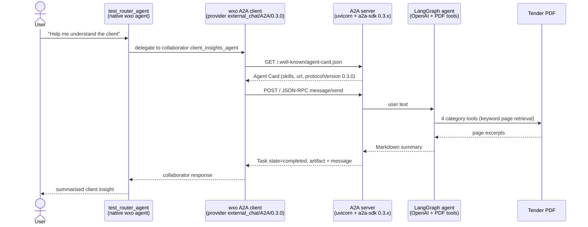

# A2A test: native wxo router agent → LangGraph agent

**Status: partially complete.** The LangGraph agent and its A2A server work and were tested directly. Both agents are imported into watsonx Orchestrate. The full wxo → A2A → wxo round trip has **not** been verified. See [Gaps and open issues](#6-gaps-and-open-issues), which should be read first.

## 1. Goal

Test Agent-to-Agent (A2A) interoperability between:

- **`test_router_agent`**: a native watsonx Orchestrate (wxo) agent, defined with the ADK spec.
- **`client_insights_agent`**: a LangGraph agent using an OpenAI model. It parses the tender PDF in `docs/` and extracts client background, requirements, pain points and key drivers.

Intended flow:

1. The user asks `test_router_agent` to help understand the client.
2. `test_router_agent` routes the request to `client_insights_agent` over A2A, discovered through its Agent Card.
3. `client_insights_agent` extracts and summarises the answer from the PDF and returns it.
4. `test_router_agent` presents the result to the user.

## 2. Architecture



The A2A side of the diagram was tested directly with [`tests/a2a_client.py`](../tests/a2a_client.py). The wxo-to-server hops (`R → W → S`) were **not** observed working. See gap 1.

### Components

| Component | Location | Role |
|---|---|---|
| PDF tools | [`agents/client_insights_agent/pdf_tools.py`](../agents/client_insights_agent/pdf_tools.py) | Loads the PDF with `pypdf` (112 pages), scores pages by keyword, returns excerpts. Six LangChain tools: overview, background, requirements, pain points, key drivers, free-text search. |
| LangGraph agent | [`agents/client_insights_agent/graph.py`](../agents/client_insights_agent/graph.py) | `langchain.agents.create_agent` (LangGraph-based tool-calling agent) with `ChatOpenAI`. Reads `OPENAI_API_KEY` from `.env`. Model defaults to `gpt-4o-mini` (`OPENAI_MODEL` overrides it). |
| A2A server | [`agents/client_insights_agent/server.py`](../agents/client_insights_agent/server.py) | Builds the Agent Card, an `AgentExecutor` that wraps the agent, and an `A2AStarletteApplication`. Served by uvicorn. |
| External agent spec | [`agents/wxo_agents/client_insights_agent.agent.yaml`](../agents/wxo_agents/client_insights_agent.agent.yaml) | wxo registration of the A2A agent (`kind: external`, `provider: external_chat/A2A/0.3.0`). |
| Native router spec | [`agents/wxo_agents/test_router_agent/test_router_agent.agent.yaml`](../agents/wxo_agents/test_router_agent/test_router_agent.agent.yaml) | `kind: native`, `style: react_core`, `llm: groq/openai/gpt-oss-120b`, collaborator `client_insights_agent`. |
| Direct A2A client | [`tests/a2a_client.py`](../tests/a2a_client.py) | Fetches the card and sends `message/send`, with no wxo involved. |
| Scripts | [`scripts/`](../scripts) | Create and activate the wxo environment; start and stop the local A2A server. |

### Key design decisions

- **A2A 0.3.0, JSON-RPC only.** The wxo docs state that 0.3.0 is the supported version and that wxo supports A2A only over JSON-RPC 2.0 on HTTP. `requirements.txt` pins `a2a-sdk>=0.3,<0.4` because the latest SDK (1.x) implements a newer spec. An unpinned install first resolved 1.2.2, and I downgraded to 0.3.26.
- **Non-streaming, no push notifications.** The card advertises `streaming: false` and `push_notifications: false`, and the external agent spec sets `chat_params.stream: false`. This is the simplest path for a test.
- **Retrieval, not full-document prompting.** The PDF is about 170k characters. Each tool scores pages by keywords and returns the top 5 pages, within a 9,000-character budget. Page ranges are restricted per category: pages 1–17 for the narrative, and 81 onward for the Appendix C tender criteria. Without that restriction, Appendix A/B boilerplate dominated the results.
- **Pain points and key drivers are inferred.** The tender doesn't state them explicitly. The system prompt tells the model to label such statements `(inferred)`.

## 3. Setup (Python 3.13)

Prerequisites: [`uv`](https://docs.astral.sh/uv/), and a `.env` at the repo root containing `WXO_API_KEY`, `WXO_URL` and `OPENAI_API_KEY`. The file is git-ignored.

```bash
uv venv --python 3.13 .venv
uv pip install --python .venv/bin/python -r requirements.txt
source .venv/bin/activate          # puts the `orchestrate` CLI on PATH

./scripts/create_wxo_env.sh        # creates wxo_unipart_env (no-op if it exists)
./scripts/activate_wxo_env.sh      # activates it using WXO_API_KEY from .env
```

Tested with Python 3.13.13 and ADK 2.18.1.

## 4. Running it

### 4.1 Run and test the LangGraph A2A server on its own (verified)

```bash
./scripts/start_a2a_stack.sh                 # uvicorn on http://localhost:10000
curl http://localhost:10000/.well-known/agent-card.json
.venv/bin/python tests/a2a_client.py         # card fetch + message/send + printed answer
./scripts/stop_a2a_stack.sh
```

### 4.2 Register the agents in wxo (import verified, deploy not run)

```bash
orchestrate agents import -f agents/wxo_agents/client_insights_agent.agent.yaml
orchestrate agents import -f agents/wxo_agents/test_router_agent/test_router_agent.agent.yaml
```

### 4.3 End-to-end test (not verified)

```bash
orchestrate chat ask --agent-name test_router_agent \
  "I need to understand the client. Give me their background, requirements, pain points and key drivers."
```

Expected: the router delegates to `client_insights_agent`, and the A2A server log (`.run/server.log`) shows the incoming request.

## 5. What was verified

| Check | Result |
|---|---|
| Python 3.13.13 venv; dependencies install from `requirements.txt` | Done |
| PDF text extraction (112 pages) and per-category retrieval | Done. Pages returned look relevant. |
| Agent Card served at `/.well-known/agent-card.json`, `protocolVersion: 0.3.0` | Done |
| Direct A2A client → server → OpenAI → PDF tools; task reached `completed` with a structured four-section answer | Done (one run) |
| `wxo_unipart_env` activated with the `.env` credentials | Done |
| `client_insights_agent` (external) and `test_router_agent` (native) imported | Done. Both reported success. |

## 6. Gaps and open issues

Ordered by importance.

### 1. wxo cannot reach `localhost` (probable blocker, not yet observed)

`client_insights_agent.agent.yaml` sets `api_url: http://localhost:10000`. The active environment, `wxo_unipart_env`, points at the SaaS tenant `api.eu-gb.watson-orchestrate.cloud.ibm.com`, which runs in IBM Cloud. A cloud-hosted collaborator call can't reach a server on this Mac's `localhost`. I expect the router's A2A call to fail for that reason, but I never saw the failure because of gap 2.

I first tried a Cloudflare tunnel to bridge this. You asked for a local server instead, so I removed the tunnel and uninstalled `cloudflared`. The server is now local only. **A decision is needed on how wxo should reach it.** Options, none tried yet:

| Option | What it needs | Open questions |
|---|---|---|
| A. wxo Developer Edition (the `local` env at `http://localhost:4321`) | Developer Edition running in containers (Podman is installed). The agent URL would be the host address as seen from inside the containers, such as `host.containers.internal` (Podman) or `host.docker.internal` (Docker). | I did not check whether Developer Edition is running or configured. I did not check whether its model catalogue includes `groq/openai/gpt-oss-120b`. The agent spec is the same, but the `api_url` changes. |
| B. Expose the local server publicly (tunnel) | A tunnel tool. | You already declined this. Listed for completeness. |
| C. Host the A2A server somewhere the SaaS tenant can reach | A deployment target. | Out of scope so far. |

If the URL changes, update both `api_url` in the YAML and `A2A_PUBLIC_URL` for the server, so the Agent Card's `url` and the registration agree.

### 2. The end-to-end run produced no result

I ran `orchestrate chat ask --agent-name test_router_agent …` twice. The first failed because `timeout` doesn't exist on macOS. The second was cancelled with no output, and I don't know whether the command hung or the tool wrapper cancelled it. The server log was empty afterwards, which is inconclusive. I had truncated the log while the server was still writing to it. The full round trip is therefore unverified.

### 3. "Deployed on the project" is not satisfied

I ran `orchestrate agents import`, which created the agents in the `Global workspace` of `wxo_unipart_env`. I did not run `orchestrate agents deploy`. I also don't know which "project" you meant. If it is a specific workspace or project, tell me and I'll target it.

### 4. The Agent Card is served but wxo doesn't consume it yet

You asked for Agent Cards to be used. The server publishes a valid card, but I registered the external agent from a hand-written YAML instead of letting wxo read the card. `orchestrate agents discover -u <base-url>` does that (default path `.well-known/agent-card.json`), and I haven't tried it. Use it once gap 1 is settled.

### 5. Smaller things to check

- After import, `orchestrate agents list` showed `test_router_agent` with style `react_intrinsic`, although the YAML says `react_core`. I did not look into why. It may be the platform's internal name, or a mapping I misread.
- The `groq/openai/gpt-oss-120b` model was picked from `orchestrate models list`. The import accepted it, but I never saw it execute.
- `OPENAI_MODEL` defaults to `gpt-4o-mini` because you didn't specify one.

### 6. Missing deliverables

The plan had a deployment script and an automated end-to-end test script. I didn't write either. The only test is the direct client, [`tests/a2a_client.py`](../tests/a2a_client.py).

### 7. Answer quality and robustness

- The four-section output is grounded in retrieved pages, but "key drivers" omitted the evaluation weightings (technical 70%, price 25%, gain/pain share 5%) even though the retrieved pages cover them. The prompt or retrieval needs tuning.
- Some "inferred" statements go slightly beyond the text. For example, the output says the consolidation "aims to reduce costs", while the tender says "efficiency opportunities".
- The page ranges (1–17 and 81 onward) are hard-coded for this specific PDF and won't carry over to another tender.
- Keyword scoring is crude. I chose it for simplicity, not accuracy.

### 8. Housekeeping

- [`server.py`](../agents/client_insights_agent/server.py) has unused imports (`asyncio`, `new_text_artifact`) and a stray `import os` mid-file. I haven't run a linter (`pyflakes` isn't installed).
- `.run/` holds stale files from the removed tunnel (`tunnel.log`, `local_test_server.*`). It is git-ignored.
- `scripts/start_a2a_stack.sh` and `stop_a2a_stack.sh` keep their "stack" names but now only manage the single uvicorn server.
- `.gitignore` has a `.run/` entry that I added. It was also modified outside my edits during the session.

### 9. Secret exposure

Early in the session I ran a `grep` over `.env` that printed `WXO_API_KEY` and `WXO_URL` into the conversation output. The file is git-ignored, but the key value now sits in this transcript. **Consider rotating `WXO_API_KEY`.**

## 7. Suggested next steps

1. Decide gap 1 (how wxo reaches the A2A server).
2. Update `api_url` and `A2A_PUBLIC_URL` to match, then re-register with `orchestrate agents discover`.
3. Run the end-to-end chat and capture the server log as evidence.
4. Run `orchestrate agents deploy` for the target workspace or project.
5. Add the deploy and end-to-end test scripts.
